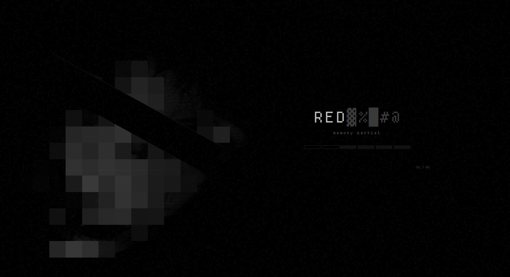
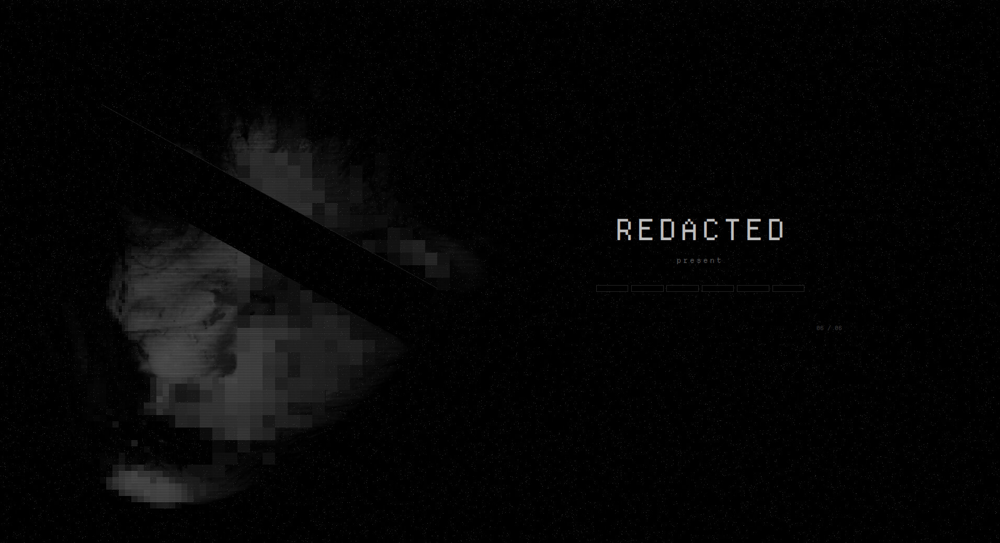

# Redacted — Global Theme (Plasma 6)

The Redacted global theme. It switches Plasma to the whole monochrome-black suite at once and ships the censored-face splash screen.


Redacted is a monochrome-black look for KDE Plasma 6 about obfuscation and censorship. Every colour is a neutral grey, and the accents sit only a few levels above black: almost imperceptible, but just perceptible. The motifs are static, mosaic pixelation, black censor bars and a dissociated double.

## Features

- **Splash screen:** a grey face under a coarse mosaic that resolves one stage at a time as Plasma starts. The name unscrambles out of glyph noise, and a strip of censor blocks shows progress. A censor bar stays across the eyes.
- **Defaults:** sets the colour scheme, Plasma style, icons, Kvantum widget style, Aurorae window decoration, splash and wallpaper to Redacted.
- **No panel layout:** it ships none, so applying it never rearranges your panels or widgets.





## Requirements

Plasma 6. Install the other Redacted pieces first (colour scheme, Plasma style, Aurorae, icons, Kvantum). The global theme falls back to Breeze for anything missing. Kvantum needs `kvantum` installed.

## Install

```bash
git clone https://github.com/numbpill3d/redacted-global
cd redacted-global && ./install.sh
```

Or from the KDE Store: System Settings → Colors & Themes → Global Theme → Install from File, or extract it to `~/.local/share/plasma/look-and-feel/`. To use only the splash, pick it under Colors & Themes → Splash Screen.

## The rest of the suite

| piece | repo |
|---|---|
| Plasma style (panel, popups) | [redacted-plasma](https://github.com/numbpill3d/redacted-plasma) |
| Aurorae window decoration | [redacted-aurorae](https://github.com/numbpill3d/redacted-aurorae) |
| Colour scheme | [redacted-colors](https://github.com/numbpill3d/redacted-colors) |
| Kvantum widget style | [redacted-kvantum](https://github.com/numbpill3d/redacted-kvantum) |
| Icon theme | [redacted-icons](https://github.com/numbpill3d/redacted-icons) |
| Konsole + kitty colours | [redacted-konsole](https://github.com/numbpill3d/redacted-konsole) |
| SDDM login | [redacted-sddm](https://github.com/numbpill3d/redacted-sddm) |
| Plymouth boot splash | [redacted-plymouth](https://github.com/numbpill3d/redacted-plymouth) |
| Animated wallpaper (desktop + lock) | [redacted-wallpaper](https://github.com/numbpill3d/redacted-wallpaper) |
| Still wallpaper (1080p–4K) | [redacted-image-wallpaper](https://github.com/numbpill3d/redacted-image-wallpaper) |
| KWin open/close effect | [redacted-censor](https://github.com/numbpill3d/redacted-censor) |
| KWin script: active window under review | [redacted-static](https://github.com/numbpill3d/redacted-static) |
| Clock plasmoid | [redacted-clock](https://github.com/numbpill3d/redacted-clock) |

Everything at once, with the generators: [redacted](https://github.com/numbpill3d/redacted).

## Tags

`redacted` `kde` `plasma6` `dark` `black` `monochrome` `grayscale` `minimal` `censored` `glitch` `static` `pixel` `global-theme` `look-and-feel` `splash-screen` `ksplash` `plasma-6`

## Credits and licence

By splicer scorn (voidrane). GPL-3.0-or-later.
Shader preamble from Burn-My-Windows by Simon Schneegans (GPL-3.0-or-later).
